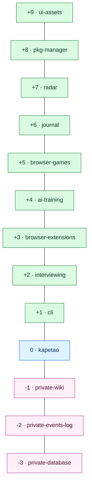

# kapetao

**Main account — holds the code, reviews the pull requests.**

`kapetao` owns the canonical public repositories and approves every change. Its paired
**machine account** [`kapetim`](https://github.com/kapetim) forks each public repo and opens pull
requests; every repo requires a PR with **1 approving review**, with admins enforced — so nothing
reaches `main` without review here.

## Repositories

The block below is the whole building: public floors above ground, the hub (`kapetao`) on the
ground floor, and the private repositories underground — titles only; their contents stay private.

<!-- BEGIN status-table -->

| Floor | Repo | Tag | Size | CI |
|------:|------|-----|------|----|
| ☀️ +9 | [ui-assets](https://github.com/kapetao/ui-assets) | — | — | — |
| ☀️ +8 | [pkg-manager](https://github.com/kapetao/pkg-manager) | — | — | — |
| ☀️ +7 | [radar](https://github.com/kapetao/radar) | — | — | — |
| ☀️ +6 | [journal](https://github.com/kapetao/journal) | — | — | — |
| ☀️ +5 | [browser-games](https://github.com/kapetao/browser-games) | — | — | — |
| ☀️ +4 | [ai-training](https://github.com/kapetao/ai-training) | — | — | — |
| ☀️ +3 | [browser-extensions](https://github.com/kapetao/browser-extensions) | — | — | — |
| ☀️ +2 | [interviewing](https://github.com/kapetao/interviewing) | — | — | — |
| ☀️ +1 | [cli](https://github.com/kapetao/cli) | — | — | — |
| 🏢 0 | [kapetao](https://github.com/kapetao/kapetao) | — | — | — |
| 🌑 -1 | [private-wiki](https://github.com/kapetao/private-wiki) | — | — | — |
| 🌑 -2 | [private-events-log](https://github.com/kapetao/private-events-log) | — | — | — |
| 🌑 -3 | [private-database](https://github.com/kapetao/private-database) | — | — | — |
<!-- END status-table -->
